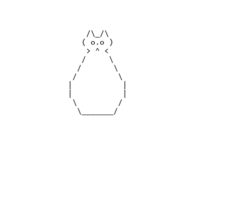
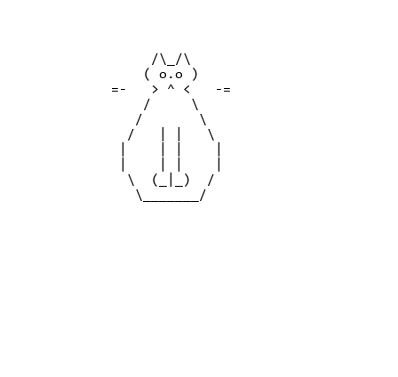
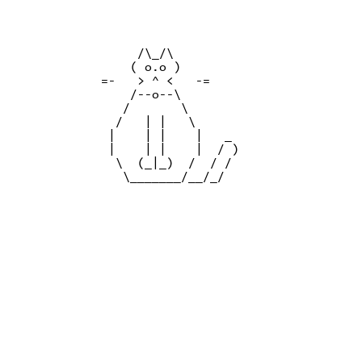
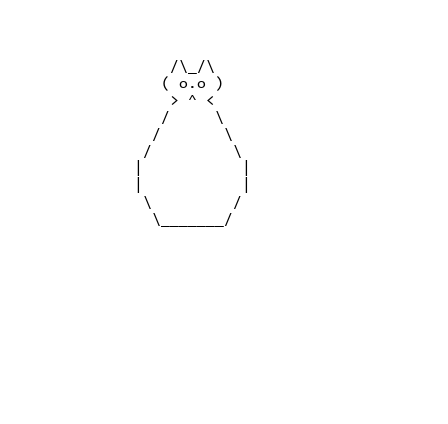
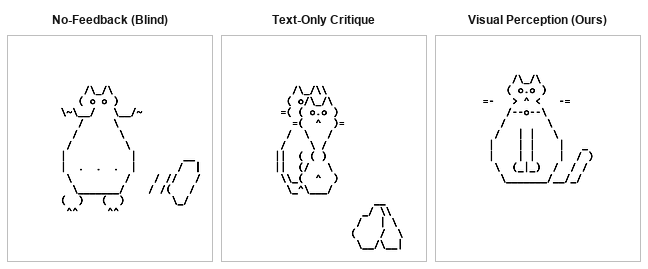
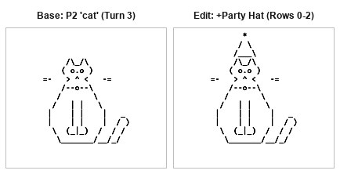
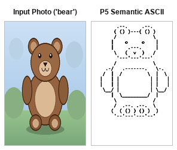
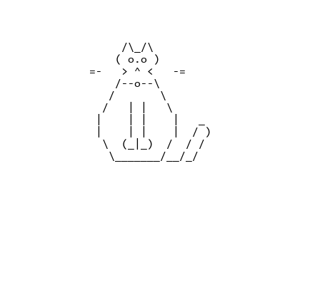
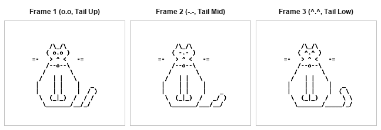
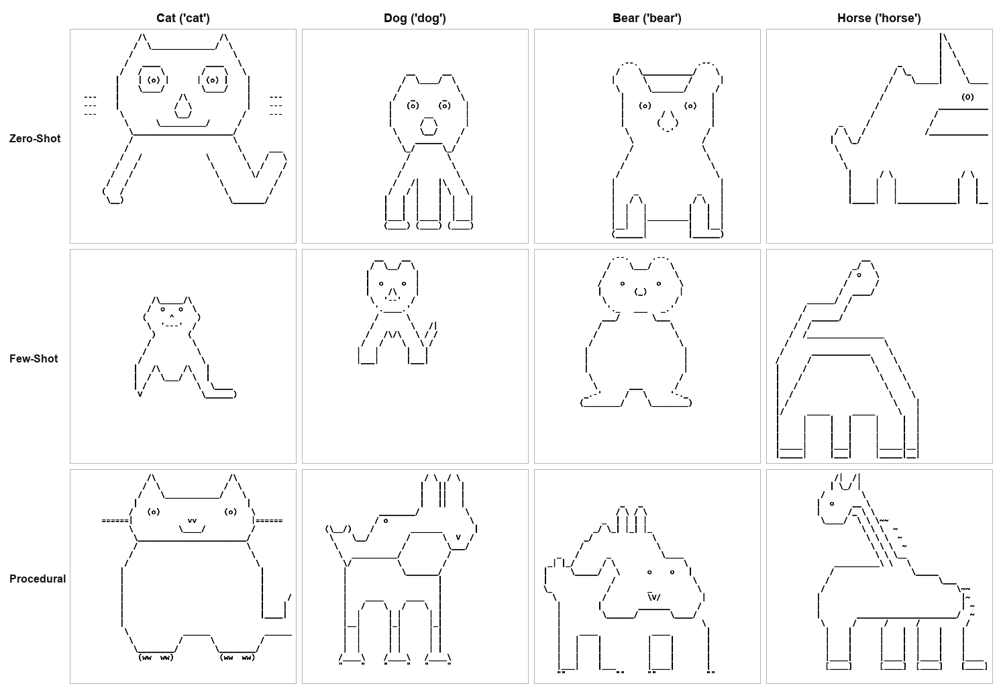

# ASCIIgent: Agentic ASCII Art Generation

**Authors:** Hana Hasan, Amit Arad, Roei Levi, Tom Shur  
**Paper (3-Page PDF):** [`report/main.pdf`](report/main.pdf) | **LaTeX Source:** [`report/main.tex`](report/main.tex)

ASCIIgent is a training-free framework for generating, refining, editing, and animating ASCII art ($24 \times 48$ printable character grids) using multimodal Vision-Language Models (VLMs). Instead of emitting an entire character grid in a single left-to-right pass—which suffers from scanline drift, glyph collapse, and lexical leakage—ASCIIgent executes a closed-loop **draft $\to$ render $\to$ perceive $\to$ revise** cycle over a discrete spatial toolset (`AsciiCanvas`).

---

## Visual Walkthrough & Interactive Showcase

### 1. P2: Agentic Self-Perception Loop (`draft` $\to$ `render` $\to$ `perceive` $\to$ `revise`)

Why **3 turns**? A 3-turn budget ($T_{\max}=3$) mirrors a coarse-to-fine artistic workflow while keeping free-tier API latency low. In each turn, the agent does **not** place just a single character—it emits a **JSON batch of spatial tool actions** (`patch_edit`, `draw_line`, `draw_rect`, `shade_density`), after which the canvas is deterministically rasterized to a PNG bitmap and paired with a 2-digit row/column coordinate ruler for visual inspection in the next turn.

| Turn | What the VLM Receives | Agent Action Batch (JSON) | Rendered Canvas State |
| :--- | :--- | :--- | :---: |
| **Turn 1**<br>*(Coarse Draft)* | **Text Prompt:**<br>`"Draw a 'cat' on the 24x48 canvas. Lay down the primary outer silhouette and core facial landmarks."` | Issues `patch_edit` at row 3, col 14 to lay down the pointed ears `/\_/\`, eyes `( o.o )`, nose `> ^ <`, and outer torso contour `/ ... \`. |  |
| **Turn 2**<br>*(Visual Critique & Anatomy)* | **Rendered Turn 1 PNG** + **2-Digit Coordinate Grid** + **Critique Prompt:**<br>`"Inspect the rendered image. Identify missing anatomical features and emit localized patch_edit calls."` | Perceives missing whiskers and front legs; issues 3 `patch_edit` actions adding left whiskers `=-`, right whiskers `-=`, and seated front paws `\| \|` / `(_\|_)`. |  |
| **Turn 3**<br>*(Fine Detail & Finish)* | **Rendered Turn 2 PNG** + **2-Digit Coordinate Grid** + **Critique Prompt** | Perceives missing collar and tail; issues `patch_edit` for the bell collar `/--o--\` and curled right tail `_`, `/ )`, `/ /`, then emits `{"action": "finish"}`. |  |

<p align="center">
  <br>
  <em>Live replay of the 3-turn agentic synthesis loop (<code>runs/20261028T120613-p2-cedeb4/progression.gif</code>).</em>
</p>

#### Feedback Mode Ablation (`no_feedback` vs. `text_only` vs. `visual`)
Removing the rendered bitmap between turns causes multi-turn edits to fail:
* **`no_feedback` (Blind):** Overwrites the nose and places floating disconnected feet/tail to the right of the body.
* **`text_only` (Raw Text Grid Only):** Misaligns vertical row indices, stamping a duplicate face directly over the cat's chest.
* **`visual` (Rendered PNG + 2-Digit Ruler — Ours):** Grounds every localized edit accurately.

<p align="center">
  
</p>

---

### 2. Unified Downstream Applications (P4, P5, P6)

To ensure strict experimental continuity, both **P4 (Conversational Editing)** and **P6 (Keyframe Animation)** start directly from the **exact Turn 3 `cat` canvas generated by our P2 agentic loop above**.

#### A. P4: Localized Conversational Editing (`asciigent/experiments/p4_edit.py`)
* **Starting Canvas:** P2 Turn 3 `cat` (`runs/p4_edit/before.txt`)
* **User Instruction:** `"Add a pointy party hat with a star on top of the head"`
* **Agent Response:** Using the rendered PNG and 2-digit column ruler (which shows the ears `/\_/\` spanning columns 18–22 on row 3), the agent emits a localized `patch_edit` on rows 0–2:
```json
[
  {
    "action": "patch_edit",
    "top_left": [0, 18],
    "patch": [
      "  *  ",
      " / \\ ",
      "/___\\"
    ]
  }
]
```
* **Result:** Only **8 cells** on rows 0–2 are modified; rows 3–23 (ears, face, whiskers, collar, torso, paws, tail) remain **100% untouched**.

<p align="center">
  
</p>

---

#### B. P5: Semantic Image-to-ASCII (`asciigent/experiments/p5_image2ascii.py`)
* **Input Photograph:** [`runs/p5_image2ascii/input_photo.png`](runs/p5_image2ascii/input_photo.png) ($320 \times 320$ RGB shaded illustration of a seated bear against sky, grass, and foliage clutter).
* **Result:** Rather than performing pixel-intensity thresholding, the VLM ignores the background clutter and shading gradients to extract a clean $24 \times 48$ structural contour ([`runs/p5_image2ascii/output.png`](runs/p5_image2ascii/output.png)).

<p align="center">
  
</p>

---

#### C. P6: Delta-Patched Keyframe Animation (`asciigent/experiments/p6_animate.py`)
* **Starting Keyframe (`frame_000`):** P2 Turn 3 `cat` (`runs/p6_animate/frame_000.txt`)
* **How Motion is Controlled Without Body Drift:** Regenerating an entire $24 \times 48$ grid from scratch on every frame causes vertical row shifts and mutating limbs. Instead, `p6_animate.py` initializes each frame $t$ from `AsciiCanvas(base=prev_grid)` and prompts the VLM to emit **only `patch_edit` deltas** for moving sub-regions:
  * **Eye Blink Delta (Row 4, Col 17):** `( o.o )` $\to$ `( -.- )` $\to$ `( ^.^ )`
  * **Tail Wag Delta (Rows 9–12, Cols 28–33):** Tail tip shifts smoothly from upright (`_ / )`) to mid (`_/ )`) to low (`( \`).
* **Result:** 100% of the head, ears, whiskers, collar, torso, and paws remain invariant across all frames.

<p align="center">
  <br>
  
</p>

---

### 3. P1: One-Shot Baselines & Multi-Model Gemini Comparison

We evaluate three one-shot prompting strategies (**Zero-Shot**, **Few-Shot** with 4 disjoint exemplars `fish`/`house`/`tree`/`sailboat`, and **Procedural Chain-of-Thought**) across four seen categories (`cat`, `dog`, `bear`, `horse`) on **two Gemini family models**:
1. **`gemini-3-flash-preview`** (Reasoning-enabled multimodal Flash model — shown in the 12-cell contact sheet below)
2. **`gemini-3.1-flash-lite`** (Lightweight fast baseline model)

<p align="center">
  
</p>

| Model | Mean Ink Ratio ($\rho$) | Mean Coverage | Mean Entropy $H$ (bits) | Mean Distinct Chars | Lexical Leakage (`spells_name`) |
| :--- | :---: | :---: | :---: | :---: | :---: |
| **`gemini-3-flash-preview`** | $0.115 \pm 0.036$ | $0.55 \pm 0.22$ | **$2.33 \pm 0.32$** | **$8.3 \pm 1.7$** | **0 / 12 cells** |
| **`gemini-3.1-flash-lite`** | $0.100 \pm 0.038$ | $0.48 \pm 0.13$ | $1.86 \pm 0.63$ | $7.0 \pm 2.9$ | 1 / 12 cells (`horse` procedural) |

---

## Repository Structure

```text
asciigent/
├── asciigent/                   # Core Python package (flat layout — no src/ wrapper)
│   ├── actions.py               # Discrete action space & AsciiCanvas (Bresenham lines, rects, tonal ramps, patch_edit)
│   ├── agent.py                 # Multi-turn active visual perception loop (visual, text_only, no_feedback)
│   ├── contact_sheet.py         # Contact sheet generator
│   ├── env.py                   # Automatic .env loader
│   ├── grid.py                  # 24×48 AsciiGrid, 2-digit coordinate rulers, scrambling controls
│   ├── judge.py                 # VLM Model-as-Judge with scrambled control gap
│   ├── llm.py                   # Disk-cached, zero-budget-enforced multimodal LLM client
│   ├── llm_types.py             # Usage tracking, LLMResponse, price tables
│   ├── metrics.py               # Structural metrics (ink ratio, coverage, Shannon entropy, spells_name)
│   ├── metrics_vision.py        # CLIP ViT-B/32 cosine similarity on rendered bitmaps
│   ├── providers.py             # Provider presets (gemini, openrouter, groq, local)
│   ├── render.py                # Deterministic cell-by-cell monospace bitmap renderer
│   ├── store.py                 # Per-run artifact logging and JSONL index persistence
│   ├── experiments/
│   │   ├── p1_text2ascii.py     # P1: One-shot baseline sweep (zero-shot, few-shot, procedural CoT)
│   │   ├── p2_agent.py          # P2: Multi-turn agentic loop & feedback mode ablation
│   │   ├── p3_judge.py          # P3: Calibrated VLM judge with scrambled controls
│   │   ├── p4_edit.py           # P4: Localized conversational editing via patch_edit
│   │   ├── p5_image2ascii.py    # P5: Semantic photograph-to-ASCII abstraction
│   │   └── p6_animate.py        # P6: Delta-patched keyframe ASCII animation
│   └── prompts/
│       ├── agent.py             # System, draft, and visual critique prompts
│       ├── judge.py             # Unprompted identify and 1–5 rating prompts
│       └── text2ascii.py        # Shared 24×48 canvas contract for P1 baselines
├── data/
│   ├── categories.json          # Seen, held-out, and exemplar-only splits
│   └── exemplars/               # Hand-crafted exemplars (fish, house, sailboat, tree)
├── report/
│   ├── main.tex                 # 3-page LaTeX report
│   ├── main.pdf                 # Compiled 3-page PDF report with all figures
│   ├── references.bib           # BibTeX bibliography
│   └── figures/                 # High-contrast figures used in the report
├── runs/                        # Saved experimental runs, turn renders, input_photo.png, and GIF/HTML animations
├── scripts/
│   ├── analyze_p1.py            # Quantitative summary tables for P1 (reports each model separately)
│   ├── evaluate_clip.py         # CLIP ViT-B/32 evaluation with scrambled controls
│   ├── generate_report_figures.py # Rebuilds Figures 2–6 from runs/
│   ├── make_grid_contact_sheet.py # Rebuilds Figure 1 (12-cell P1 contact sheet)
│   └── run_judge_text_vs_image.py # Image-vs-text VLM judge comparison
└── tests/                       # 87 offline unit and integration tests
```

---

## Quickstart & Reproducibility

Because `asciigent/` is located directly at the repository root, all commands run straight from the root directory without needing `PYTHONPATH`.

### 1. Install Dependencies & Run Unit Tests
```powershell
pip install -r requirements.txt
python -m pytest tests/ -q
```

### 2. Configure API Key (Optional for Cached Runs)
```powershell
cp .env.example .env
# Add your free GEMINI_API_KEY inside .env
```

### 3. Run Experiments Across Models (P1–P6)
```powershell
# P1: Run 12-cell seen sweep on gemini-3-flash-preview or gemini-3.1-flash-lite
python -m asciigent.experiments.p1_text2ascii --split seen --samples 1 --model gemini-3-flash-preview --effort low
python -m asciigent.experiments.p1_text2ascii --split seen --samples 1 --model gemini-3.1-flash-lite
python scripts/analyze_p1.py runs/index.jsonl

# P2: Agentic Self-Perception Loop & Feedback Ablation (3 turns)
python -m asciigent.experiments.p2_agent --category cat --max-turns 3 --feedback visual --model gemini-3.1-flash-lite
python -m asciigent.experiments.p2_agent --category cat --max-turns 3 --feedback text_only --model gemini-3.1-flash-lite
python -m asciigent.experiments.p2_agent --category cat --max-turns 3 --feedback no_feedback --model gemini-3.1-flash-lite

# P3: Calibrated VLM Judge & CLIP Evaluation
python -m asciigent.experiments.p3_judge --runs-dir runs --model gemini-3.1-flash-lite
python scripts/evaluate_clip.py runs/index.jsonl

# P4: Localized Conversational Editing (starts from P2 Turn 3 cat)
python -m asciigent.experiments.p4_edit --drawing runs/p4_edit/before.txt --instruction "add a pointy party hat with a star on top of the head" --model gemini-3.1-flash-lite

# P5: Semantic Image-to-ASCII (uses runs/p5_image2ascii/input_photo.png)
python -m asciigent.experiments.p5_image2ascii --image runs/p5_image2ascii/input_photo.png --model gemini-3.1-flash-lite

# P6: Delta-Patched Keyframe Animation (starts from P2 Turn 3 cat)
python -m asciigent.experiments.p6_animate --category cat --frames 3 --model gemini-3.1-flash-lite
```

### 4. Rebuild All Report Figures
```powershell
python scripts/make_grid_contact_sheet.py
python scripts/generate_report_figures.py
```
