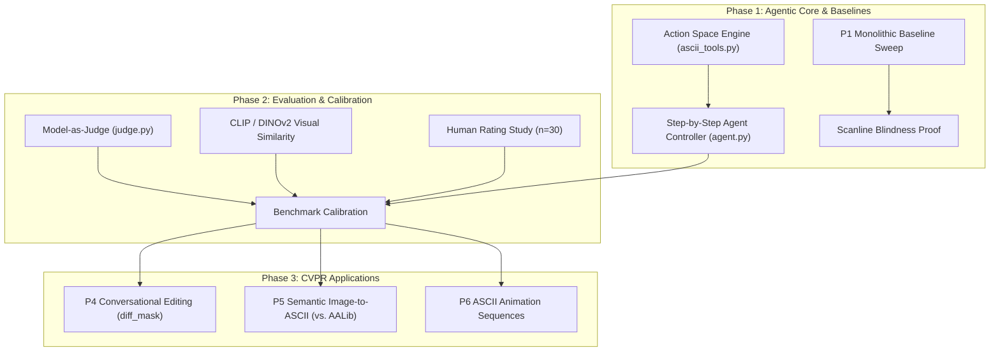

# ASCIIgent: Language-Driven Agentic ASCII Art Generation
## CVPR Research Blueprint, Architectural Extension & Action Plan

---

## 1. Executive Summary: Bridging the Gap to CVPR

The current project proposal and initial codebase establish rigorous software hygiene (damage reports, format contracts, and Wang et al. text-bias controls). However, there is a fundamental gap between the current state and a conference paper accepted at **CVPR**:

```
Current State (Prompting Benchmark):
[Text Category] ──> [LLM outputs monolithic 24x48 character dump] ──> [Render] ──> [Post-hoc VLM judge]
Problems:
1. Autoregressive scanline blindness: commits to top-row characters without spatial foresight for bottom rows.
2. Passive generation: not an agent; no tool-use, no intermediate canvas state.
3. Brittle revision: asking an LLM to re-emit 1,152 characters causes coordinate drift and hallucinated rewrites.

CVPR-Grade ASCIIgent (Agentic Active-Perception Framework):
[Text / Image Prompt]
       │
       ▼
[Hierarchical Semantic Plan] (Bounding boxes, parts layout, anchor primitives)
       │
       ▼
┌──> [Action Step t] (draw_stroke, shade_region, stamp_feature, patch_edit)
│      │
│      ▼
│    [AsciiGrid Canvas Engine] (Stateful 24x48 discrete canvas)
│      │
│      ▼
│    [Visual Rendering & Active Feedback] (VLM inspects intermediate canvas bitmap)
│      │
└──── [Spatial Error Detection & Localized Revision] (Loop until convergence)
       │
       ▼
[Final Output] (Supports zero-shot transfer, conversational editing, and animation)
```

### Why ASCII Art is a High-Impact Problem for Multimodal Vision
In vector sketching (like *SketchAgent*, CVPR 2025), strokes are continuous Bézier curves. ASCII art poses an even deeper, unaddressed vision-language question:
1. **The Dual Nature of the Alphabet:** In ASCII, characters simultaneously function as **language tokens** (with semantic priors) and **geometric/tonal micro-primitives** (e.g., `/`, `\`, `|`, `_` are directional edges; `@`, `#`, `8`, `%` are tonal density/fill; `.`, `'`, `,` are stippling).
2. **The "Scanline Blindness" Paradox:** Autoregressive language models generate line-by-line (top-to-bottom, left-to-right). Human ASCII artists **never** draw this way; they sketch silhouettes, outline features, and fill shading. Proving that an agentic action space overcomes scanline blindness is a major CVPR contribution.
3. **Training-Free Emergent Spatial Reasoning:** Showing that a frozen, off-the-shelf VLM can plan, execute, and self-correct discrete symbolic art purely through active visual perception.

---

## 2. CVPR Paper Specification

### Working Title
> **ASCIIgent: Language-Driven Sequential ASCII Art Generation via Active Visual Perception**

### Abstract Pitch
> While Vision-Language Models (VLMs) have demonstrated impressive visual understanding and vector sketch synthesis, generating ASCII art remains an elusive challenge: standard autoregressive generation suffers from scanline blindness, failing to maintain global spatial coherence across discrete character matrices. In this work, we introduce **ASCIIgent**, a training-free framework that enables a frozen multimodal LLM to act as an autonomous ASCII artist. Rather than emitting monolithic text grids, ASCIIgent decomposes visual synthesis into a dynamic, multi-turn interaction over a stateful character canvas. We equip the agent with an expressive **ASCII Action Space**—including parametric line and contour primitives, tonal luminance ramps, and localized patch manipulators—coupled with an **Active Visual Perception Loop** that renders intermediate states, visually critiques spatial proportions, and performs targeted structural corrections. Across seen and held-out semantic categories, ASCIIgent dramatically outperforms standard one-shot prompting, eliminates text-leakage artifacts, and unlocks robust **conversational editing** and **semantic image-to-ASCII abstraction**. Our calibrated evaluation protocol proves that agentic visual feedback is the critical factor enabling spatial reasoning over discrete symbolic media.

### Core Contributions (The "Delta")
1. **The Discrete ASCII Action Space:** A formal action vocabulary mapping high-level visual intent (edges, density shading, localized patches) onto a discrete $H \times W$ grid, solving the autoregressive scanline failure mode.
2. **Active Perception & Self-Correction:** An iterative loop where the agent visually inspects its rendered bitmap between drafting steps, detecting anatomical misalignments and issuing localized edit commands.
3. **Calibrated Multi-Metric Benchmark:** Calibration of VLM-as-Judge, CLIP/DINOv2 image embeddings, and human perceptual ratings, establishing a rigorous evaluation protocol resistant to character-text bias.
4. **Downstream Capabilities:** Demonstrations of natural language conversational editing (measured via ROI edit localization $\Delta$) and semantic image-to-ASCII abstraction superior to classical tone-mapping algorithms.

---

## 3. System Architecture & Formulation

### 3.1 Mathematical Formulation
* **Canvas State:** A matrix $C \in \Sigma^{H \times W}$, where $\Sigma$ is the 95 printable ASCII characters plus space (`0x20` to `0x7E`).
* **Rendering Function:** $\mathcal{R}: \Sigma^{H \times W} \to \mathbb{R}^{H' \times W' \times 3}$, rendering the monospace character grid to a continuous bitmap image at exact subpixel coordinates.
* **Action Space $\mathcal{A}$:**
  $$\mathcal{A} = \{\text{Plan}, \text{DrawStroke}, \text{DrawBox}, \text{ShadeRegion}, \text{StampFeature}, \text{PatchEdit}, \text{Erase}, \text{Finish}\}$$
* **Agent Policy $\pi_\theta(a_t \mid I_{\text{goal}}, \mathcal{R}(C_{t-1}), H_{<t})$:** A frozen multimodal model conditioning on the task prompt, the visual render of the current canvas, and the action history.

### 3.2 Discrete Action Space Definitions
```python
# 1. Structural Edges (Bresenham line with directional character selection)
draw_line(char: str, start: (r, c), end: (r, c))

# 2. Contours & Polygons
draw_polyline(chars: str, points: list[(r, c)], closed: bool)

# 3. Tonal Density Fill (Luminance Ramp)
# Ramp: " " < "." < ":" < "-" < "=" < "+" < "*" < "%" < "#" < "@"
fill_density(region: (r_min, c_min, r_max, c_max), level: int)

# 4. Feature Templates
stamp_template(template_name: str, anchor: (r, c))  # e.g., "eye_left", "wheel"

# 5. Localized Sub-grid Patch Edit
edit_patch(top_left: (r, c), new_subgrid: list[str])

# 6. Canvas Erasure
erase(top_left: (r, c), bottom_right: (r, c))
```

---

## 4. Work Packages & Implementation Roadmap



### Work Package 1: The Agentic Engine (P2)
* Implement `src/asciigent/tools/actions.py` to support drawing primitives on `AsciiGrid`.
* Implement `src/asciigent/agent.py`:
  * **Turn 0 (Hierarchical Layout):** Decompose the object into bounding boxes (e.g., Cat: Head `[2:8, 14:26]`, Ears `[0:3, 15:19]`, Body `[8:18, 10:30]`, Tail `[10:17, 28:40]`).
  * **Turn 1 to $K$ (Sequential Drafting):** Emit actions, apply to canvas, render bitmap, and append the rendered image to the multi-modal conversation.
  * **Refinement Turn:** The VLM critic inspects the intermediate rendering and outputs localized corrections via `edit_patch` or `erase`.

### Work Package 2: Rigorous Evaluation & Calibration (P3)
* **Embedding Baseline:** Compute cosine similarity between rendered ASCII bitmaps and target text/image embeddings using **CLIP (ViT-B/32 & ViT-L/14)** and **DINOv2**.
* **Structure-Destroying Controls:** Maintain the `scramble_cells` and `scramble_ink` controls from `judge.py` to measure the **Control Gap** ($S_{\text{real}} - S_{\text{scrambled}}$). A valid visual metric must yield a large positive gap.
* **Human Calibration Survey:** Collect 3–5 human ratings on 30 sample drawings to correlate automated metrics against human perceptual ground truth.

### Work Package 3: Conversational Editing (P4)
* Input: An existing ASCII drawing + instruction (e.g., *"give the bear a hat"*, *"lengthen the cat's tail"*).
* Metric: **Edit Localization Score** ($L = \text{Target ROI Accuracy} \times (1 - \text{Background Modification Ratio})$), using `grid.diff_mask()`.

### Work Package 4: Semantic Image-to-ASCII (P5)
* Benchmark against classical edge/tone mappers (AALib, jp2a, Canny-ASCII).
* Demonstrate that ASCIIgent extracts **semantic salience** (keeping eyes, facial contours, gesture) while ignoring noisy photo backgrounds.

---

## 5. Team Task Assignments (4–5 Person Plan)

| Person / Role | Primary Responsibility | Code Deliverables |
|---|---|---|
| **Member 1: Agent Lead** | Agentic loop & action space primitives | `src/asciigent/tools/actions.py`, `src/asciigent/agent.py` |
| **Member 2: Evaluation Lead** | CLIP/DINOv2 metrics & human calibration | `src/asciigent/metrics_vision.py`, human rating survey script |
| **Member 3: Applications Lead** | Conversational editing (P4) & Image-to-ASCII (P5) | `src/asciigent/experiments/p4_edit.py`, `p5_image2ascii.py` |
| **Member 4: Infra & Inference** | Local VLM pipeline (Qwen2.5-VL / vLLM), sweep runner | Multi-provider orchestration, batch inference scripts |
| **Member 5 / Shared: Paper & Analysis** | LaTeX report, figure generation, contact sheets | 2-3 page MCV report $\to$ CVPR draft, contact sheet visuals |

---

## 6. Solving the API Quota Bottleneck

To bypass the 20 requests/day free tier:
1. **Local Open-Weight VLM:** Run `Qwen/Qwen2.5-VL-7B-Instruct` or `mistralai/Pixtral-12B` locally using `vLLM` or `Ollama`. This yields **unlimited calls**, exact determinism, and zero API costs.
2. **Key Rotation Across Members:** With 4–5 team members each registering a Google AI Studio account, you obtain 80–100 calls/day across Flash 3.8 and Flash-Lite.
3. **OpenRouter Free Tiers:** Leverage `qwen/qwen-2.5-vl-72b-instruct:free` on OpenRouter.
